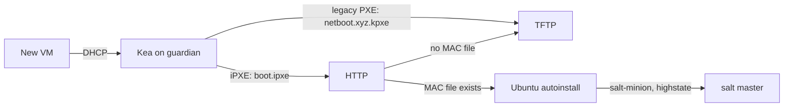

# dhcp-server

DHCPv4 for the client networks on the gateways (`gw*`) and, via `guardian.sls`, on the guardians (see below). Owned by
`@freifunkMUC/salt-stack` (see `CODEOWNERS`).

Two implementations, selected per gateway by a NetBox tag:

| Tag | Server | Config |
|---|---|---|
| none | isc-dhcp-server (unmaintained since 2022) | `dhcpd.conf` |
| `dhcp-kea` | Kea 3.0 from ISC's repository | `kea-dhcp4.conf.jinja` |

Both serve the same networks: one shared network per NetBox site prefix,
pool `.10`-`.254`, the gateway as router, 600 s default and
3600 s maximum lease time, and the same options (MTU 1280, captive portal,
DNR, UniFi and Omada controller address).

The resolvers are the two anycast IPv4 addresses, the one of the own site
first (`ddr_resolvers4` in `certs/ddr_cert.jinja`). The DDR certificate
contains these addresses, so clients can do verified DDR (RFC 9462).
radvd sends the IPv6 anycast addresses as RDNSS in the same order.

## Kea

- **Packages:** `isc-kea-dhcp4-server` and `isc-kea-hooks`, pinned to
  `3.0.5-isc20261026134027` (exact, same build on every distro). Override the version via `netbox:config_context:kea:version`;
  all Kea packages must share one version.
- **Config check:** the config is rendered to `/etc/kea/kea-dhcp4.conf` and
  checked with `kea-dhcp4 -t` before it is written (`check_cmd`). The check
  also requires every `br-<site>` interface to exist.
- **VRF:** on gateways with `vrf_external`, a drop-in runs kea-dhcp4 through
  `ip vrf exec` as root, like dhcpd before.
- **Ping check:** `libdhcp_ping_check.so` replaces dhcpd's `ping-check`. On
  DHCPDISCOVER Kea holds the offer and pings the address once, waiting up to
  1 s like dhcpd's `ping-timeout`. If it answers, the address is declined and
  the offer dropped, so the client retries and gets another address.
  Clients renewing their own active lease are not pinged. Declined addresses
  return to the pool after 1 h (`decline-probation-period`).
- **DNR (RFC 9463):** the option advertises DoH, DoT and DoQ on the anycast
  resolver (`netbox:config_context:dhcp:dnr_address`, default the first
  resolver). Unlike the raw dhcpd option it includes the resolver
  address, which RFC 9463 section 3.1.8 requires and Kea enforces.
- **Monitoring:** `/usr/local/bin/kea-pool-stats` reads the pool statistics
  from the control socket and prints the `dhcpd-pools` JSON format, so the
  telegraf measurements (`dhcpd_pools_*`) stay unchanged. With
  `--warning/--critical` it is the Icinga check `dhcp_pool_kea`. telegraf
  and nagios are added to the `_kea` group for socket access.

## Migrating a gateway

1. Add the NetBox tag `dhcp-kea` to the gateway.
2. Run a highstate. isc-dhcp-server is stopped and disabled, then Kea starts.
3. Check: `systemctl status isc-kea-dhcp4-server`, `kea-pool-stats`,
   `journalctl -u isc-kea-dhcp4-server`.

Leases are not migrated. With 600 s lease time, clients renew within minutes;
Kea hands out the requested address again if it is still free.

## Rollback

Remove the `dhcp-kea` tag and run a highstate. Kea is stopped and disabled,
and isc-dhcp-server starts again with its previous config.

## Tests

```
python3 -m unittest discover -s dhcp-server/tests
```

## Guardians (`guardian.sls`)

Raspbian bookworm (armhf), top entry `guardian-*`. ISC's repository has no
armhf packages, so the guardians run Raspbian's Kea 2.2.0 (`kea-dhcp4-server`,
unit `kea-dhcp4-server`): no hooks, hence **no ping check** (a client with a
static address inside the pool is not detected), and `output_options` /
`control-socket` in the older spelling (`kea-dhcp4-guardian.conf.jinja`).
The gateways' `init.sls` is not used and not changed.

There are no NetBox site prefixes here, so everything comes from the device's
NetBox config context `dhcp_guardian` (shape: `dhcpd_to_context.py`):

```
{"dhcp_guardian": {
  "enabled": true,
  "interfaces": ["eth0"],
  "domain_name": "<domain>",
  "valid_lifetime": 1800, "max_valid_lifetime": 3600,
  "subnets": [{"subnet": "<net/len>", "pool": "<first> - <last>", "routers": "<ip>",
               "dns": "<ip>", "next_server": "<ip>", "boot_file": "<file>",
               "reservations": [{"mac": "<mac>", "ip": "<ip>", "hostname": "<name>"}]}]}}
```

- key absent: the state does nothing (`dhcpd.conf` stays as it is)
- `enabled: true`: package, config (`kea-dhcp4 -t` as `check_cmd`), then
  isc-dhcp-server stopped and disabled, then Kea started. If the config test
  fails, dhcpd keeps serving.
- `enabled: false`: rollback, Kea stopped and disabled, isc-dhcp-server
  running again. isc-dhcp-server and its `dhcpd.conf` are never removed.

`dhcpd_to_context.py` builds the context from an existing `dhcpd.conf`
(contains MAC addresses: paste only into NetBox; `--summary` prints counts).
Leases are not migrated (lease time 1800 s, clients renew within 15-30 min).
Pool statistics (`kea-pool-stats`) are not set up on the guardians.

## Guardian PXE and unattended install (`guardian_pxe.sls`)

The guardians boot machines in their mgmt network over PXE. A host in the
install list gets Ubuntu without questions, with a salt-minion. Salt then
does the rest on first boot (Nebula, interfaces, users).



Turn it on in the config context `dhcp_guardian` (Kea must be enabled):

```
"pxe": {
  "enabled": true,
  "netbox_token": "<read-only token>",
  "install_hosts": ["<vm fqdn>"],
  "ubuntu_release": "26.04.1",           (optional)
  "ubuntu_iso_sha256": "<sha256>",       (optional, required with a new release)
  "salt_master": "saltmaster.in.ffmuc.net" (optional)
}
```

- **PXE server address and network:** `next_server` and `subnet` of the first
  Kea subnet with a `next_server`. No other address is configured.
- **TFTP:** `tftpd-hpa` on the PXE address serves `netboot.xyz.kpxe`
  (checked with sha256). `nf_conntrack_tftp` is loaded.
- **HTTP:** nginx on the PXE address, only for the mgmt network. Root
  `/srv/pxe`. It serves `boot.ipxe`, the Ubuntu ISO with its kernel and
  initrd (about 3 GB, downloaded once and checked), the per-host iPXE files
  and the autoinstall data.
- **Kea:** two client classes set the boot file; the subnet does not.
  Class `ipxe` (option 77 starts with `iPXE`, for example the QEMU NIC ROM)
  gets `http://<pxe>/boot.ipxe`. Class `legacy-pxe` (all others) gets
  `boot_file` (default `netboot.xyz.kpxe`) over TFTP.
- **boot.ipxe:** loads `/ipxe/<mac>.ipxe`. If the file does not exist, it
  loads the netboot.xyz menu.
- **Per host:** for each VM in `install_hosts` the state reads the VM from
  NetBox (`netbox_vms.get_vm_install_data`). The MAC of the interface with
  the primary IPv4 names the iPXE file. The user-data sets this interface
  static (router and DNS from the Kea subnet) and names all interfaces by
  MAC. It installs `salt-minion` (same version as `salt-minion/init.sls`)
  with `id` = FQDN and `startup_states: highstate`, and the admin SSH keys
  for root. It contains no secrets.
- **iptables:** udp/69 and tcp/80 from the mgmt network.
- **Known effect:** Kea uses a raw socket on `eth0`. If another VLAN reaches
  the guardian port, Kea also answers DHCP from that VLAN with a mgmt pool
  address (seen for an uplink MAC of a new VM). This is harmless for the
  install, but fix the switch or bridge port if you see it.

After the install, remove the host from `install_hosts` and run a highstate
on the guardian. The state removes its files, so the next PXE boot shows the
menu and does not install again.
