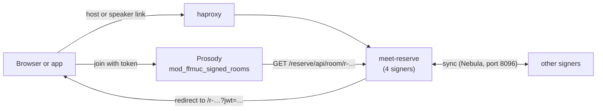

# meet-reserve

Signer for reserved rooms on meet.ffmuc.net. It runs behind
`https://meet.ffmuc.net/reserve`. `stacks/README.md` explains the deployment.

## How it works

A reserved room has the name `r-…` and three roles:

- **Host**: moderator. Uses the host link (`/reserve/h/…`).
- **Speaker**: joins the main room, not a moderator. Uses the speaker link
  (`/reserve/s/…`).
- **Viewer**: joins as a Jitsi visitor (view only). Uses the room link
  (`/r-…`).



1. A user reserves a room on the reserve page. A
   [proof of work](#proof-of-work) protects this step.
2. meet-reserve keeps a small record per room: end date, deletion, link
   generation, hashes of the link secrets. All signers share the records
   (CRDT, port 8096).
3. A host or speaker link gives a redirect to Jitsi with a short-lived
   EdDSA token (`RESERVE_LINK_TTL`).
4. Prosody checks the token and asks `/reserve/api/room/<room>` if the room is
   still active. Only hosts and speakers join the main room. All other users
   are visitors.

Rooms from v1 (long signed names, long-lived tokens) continue to work. The
first use of their manage or host link migrates them.

## Proof of work

A proof of work (PoW) makes it expensive to create many rooms. It is
necessary for `POST /reserve/api/reserve` (new room) and
`POST /reserve/api/extend` (longer room). The other API calls do not need it.

1. The client gets a challenge: `GET /reserve/api/challenge`.

   ```json
   {"challenge": "1763112000.<24 hex>.<32 hex>", "difficulty": 18,
    "durations": [72, 168, 720, 2160, 8760], "default": 72, "max_ahead_h": 8760}
   ```

   The challenge is `<unix time>.<random>.<HMAC>`. The HMAC uses
   `RESERVE_POW_KEY`. Thus meet-reserve does not store challenges.
2. The client finds a `nonce` (any text, at most 32 characters) where
   `SHA-256(challenge + ":" + nonce)` starts with `difficulty` zero bits.
   The reserve page counts up decimal numbers in Web Workers (one per CPU
   core, at most 8).
   On average this takes 2^`difficulty` hashes (about 262,000 for 18).
3. The client sends `challenge` and `nonce` in the JSON body of the POST.
4. meet-reserve checks the HMAC, the age (at most 10 minutes), the zero bits,
   and that nobody used the challenge before.

A signer keeps used challenges only in memory. Thus haproxy sends each client
IP to the same signer (`balance source`). haproxy also limits POST requests
to 60 per IP and hour.

Errors (HTTP 403): `pow_malformed`, `pow_bad_mac`, `pow_expired`,
`pow_insufficient`, `pow_replay`. Get a new challenge and try again.
`RESERVE_POW_DIFFICULTY` sets the difficulty. Each additional bit doubles the
work. The metric `ffmuc_reserve_pow_rejected_total{reason}` counts the
rejected requests.

## Prosody

Prosody must verify the tokens. Salt does this in `jitsi/prosody/`.

Needed parts:

- **Module** `mod_ffmuc_signed_rooms.lua` (`jitsi/prosody/files/`). Salt
  installs it in `/usr/local/share/ffmuc-prosody-plugins/`. This path must be
  in `plugin_paths`.
- **Upstream modules** from `jitsi-meet-prosody`: token authentication
  (`mod_auth_token`), visitors (`visitors`, `visitors_component`) and
  `room_metadata_component`. No patches are necessary.
- **Main VirtualHost**:
  - `authentication = "token"`, `app_id = ""`, `app_secret = ""`,
    `allow_empty_token = true`. Users without a token can still join normal
    rooms.
  - `modules_enabled`: `"visitors"` and `"ffmuc_signed_rooms"`.
  - The `ffmuc_signed_rooms_*` options (see below).
- **Visitors component**: `auto_allow_visitor_promotion = false`. The module
  sets auto-promotion per room. Normal rooms keep auto-promotion if
  `ffmuc_signed_rooms_auto_promote_unsigned = true`.

Salt writes all of this when the NetBox config context `jitsi` has:

```yaml
visitors:
  enabled: true
signed_rooms:
  enabled: true
  public_keys:
    "1": "<base64 raw Ed25519 public key>"   # key id = RESERVE_KEY_ID
```

| Pillar (`jitsi.signed_rooms`) | Prosody option | Default | Meaning |
|---|---|---|---|
| `public_keys` | `ffmuc_signed_rooms_public_keys` | none | Key ID to public key. Without keys, Prosody refuses all reserved rooms. |
| `lookup_url` | `ffmuc_signed_rooms_lookup_url` | `https://<public_domain>/reserve/api/room/` | Room state API. |
| `lookup_ttl` | `ffmuc_signed_rooms_lookup_ttl` | 60 | Seconds Prosody keeps a room state. New links stop old links after this time. |
| `lookup_grace` | `ffmuc_signed_rooms_lookup_grace` | 600 | Seconds Prosody uses an old state when meet-reserve is not available. After this time, Prosody refuses the room. |
| `max_extension` | `ffmuc_signed_rooms_max_extension` | 2592000 | v1 rooms only. Must be equal to `RESERVE_LEGACY_MAX_EXTENSION`. |

The module also uses `ffmuc_signed_rooms_focus_jid` and
`ffmuc_signed_rooms_focus_component` (set by Salt). Prosody metrics:
`rooms_created`, `rooms_rejected`, `tokens_accepted`, `tokens_rejected`,
`lookups`, `lookup_failures`, `rooms_closed`.

The module does these steps:

- It accepts only EdDSA tokens with `iss` `ffmuc-reserve`, `aud` `jitsi`, and
  user ID `host:<room>` or `speaker:<room>`. It refuses all other tokens.
- It checks the room before Jicofo creates the conference and on each join.
- Only hosts become owners. Jicofo cannot make other users owner.
- It closes deleted rooms within about one minute.

## Configuration

| Variable | Default | Meaning |
|---|---|---|
| `RESERVE_PRIVATE_KEY` | required | Base64 Ed25519 seed (32 bytes). Same on all signers. |
| `RESERVE_POW_KEY` | required | Base64, 32 bytes. Same on all signers. |
| `RESERVE_SYNC_KEY` | required | Base64, 32 bytes. Same on all signers. Must not be equal to `RESERVE_POW_KEY`. |
| `RESERVE_KEY_ID` | `1` | Key ID (`kid`) in the token. Must match a key in `public_keys`. |
| `RESERVE_PEERS` | empty | Sync URLs of the other signers, comma-separated. |
| `RESERVE_DOMAIN` | `meet.ffmuc.net` | Jitsi domain (`sub` claim). |
| `RESERVE_PUBLIC_URL` | `https://<domain>` | Public URL for links. |
| `RESERVE_BASE_PATH` | `/reserve` | Path prefix. |
| `RESERVE_DATA_DIR` | `/data` | Room records. |
| `RESERVE_LISTEN` | `:8095` | Public HTTP (through haproxy). |
| `RESERVE_SYNC_LISTEN` | `:8096` | Peer sync and admin. Nebula only. |
| `RESERVE_METRICS_LISTEN` | `127.0.0.1:9195` | Prometheus metrics. |
| `RESERVE_DURATIONS` | `72h,168h,720h,2160h,8760h` | Durations a user can select. |
| `RESERVE_DEFAULT_DURATION` | `72h` | Must be in `RESERVE_DURATIONS`. |
| `RESERVE_MAX_AHEAD` | `8760h` | Latest end date. |
| `RESERVE_LINK_TTL` | `12h` | Token lifetime (at least 5m). |
| `RESERVE_LEGACY_MAX_EXTENSION` | `720h` | v1 rooms only. |
| `RESERVE_POW_DIFFICULTY` | `18` | Proof-of-work bits (0..32). |
| `RESERVE_APPLE_TEAM_ID`, `RESERVE_ANDROID_CERT_SHA256` | empty | See [App links](#app-links). |

`meet-reserve genkey` prints a new private key, the public key for Prosody
and a random key for `RESERVE_POW_KEY` or `RESERVE_SYNC_KEY`.

`meet-reserve revoke <room>` deletes a room (for abuse). Run it in a running
signer container, for example
`docker compose exec meet-reserve /meet-reserve revoke r-…`. It sends the
request to the local signer on `RESERVE_SYNC_LISTEN`. The signer sends the
deletion to all other signers.

## Join API for apps

`POST /reserve/api/join` gives a token for a room. The desktop and mobile apps
use it. It needs no proof of work.

Request:

```json
{"key": "https://meet.ffmuc.net/reserve/h/…", "role": "speaker"}
```

- `key`: a host or speaker link in any form: the bare secret, the `/h/` or
  `/s/` link, the manage link (`#k=`), or a v1 host link. A v1 host link
  migrates the room, like on the manage page.
- `role` (optional): `host` or `speaker`. The default is the role of the link.
  A host link can join as `speaker`. A speaker link cannot join as `host`
  (HTTP 403, `forbidden`).

Response (HTTP 200, `Cache-Control: no-store`):

```json
{
  "server": "https://meet.ffmuc.net",
  "room": "r-…",
  "role": "host",
  "jwt": "…",
  "jwt_expires": "2026-11-01T12:00:00Z",
  "room_expires": "2026-12-01T12:00:00Z"
}
```

The token is the same as the token of the short links: it is valid for
`RESERVE_LINK_TTL`, but not after the room expires. To join, open
`<server>/<room>?jwt=<jwt>`. Get a new token before `jwt_expires`.

Errors: see below. Each `/api/join` POST counts for the haproxy POST limit.

The metric `ffmuc_reserve_api_joins_total{role}` counts the tokens.

## App links

meet-reserve serves the files that let iOS and Android open links in the
app `net.ffmuc.meet`. haproxy sends these paths on meet.ffmuc.net to
meet-reserve:

- `/.well-known/apple-app-site-association`: needs `RESERVE_APPLE_TEAM_ID`
  (10 letters or digits).
- `/.well-known/assetlinks.json`: needs `RESERVE_ANDROID_CERT_SHA256`
  (SHA-256 fingerprints of the signing certs, comma-separated, with or
  without colons).

If a value is empty, the file gives HTTP 404. The values are public. Put the
same values in all `stacks/docker0*/meet-reserve/compose.yaml`.

The app opens host links (`/reserve/h/…`), speaker links (`/reserve/s/…`),
manage links (`/reserve/#k=…`, `/reserve/#m=…`) and rooms (one path segment
without a dot, for example `/r-…`). It does not open the start page, the
reserve page, Jitsi files and APIs. Android uses the path filters of the app
manifest.

## API errors

All errors from `/reserve/api/*` are JSON:

```json
{"error": "room expired", "reason": "expired"}
```

- `error` is text for humans. It can change.
- `reason` is stable. Clients must use `reason`.

| `reason` | HTTP | Meaning |
|---|---|---|
| `malformed` | 400, 405 | The request is not correct (body, method, duration). |
| `invalid` | 400 | The key is not a valid link. |
| `unknown` | 400, 404 | No room has this key, or the link has the wrong type. |
| `forbidden` | 403 | The link does not give the requested role. |
| `replaced` | 410 | New links replaced this link. |
| `deleted` | 410 | The room was deleted. |
| `expired` | 410 | The room expired. |
| `pow_malformed`, `pow_bad_mac`, `pow_expired`, `pow_insufficient`, `pow_replay` | 403 | The proof of work is not correct. Get a new challenge. |
| `too_many_requests` | 429 | Too many POST requests from this IP. haproxy sends this error. |
| `internal` | 500 | Server error. |

## License

meet-reserve is licensed under the GNU Affero General Public License v3.0 or later (AGPL-3.0-or-later). See [LICENSE](LICENSE).

`logo.png` and `favicon.png` are the FFMUC logo. They are not covered by this license.
